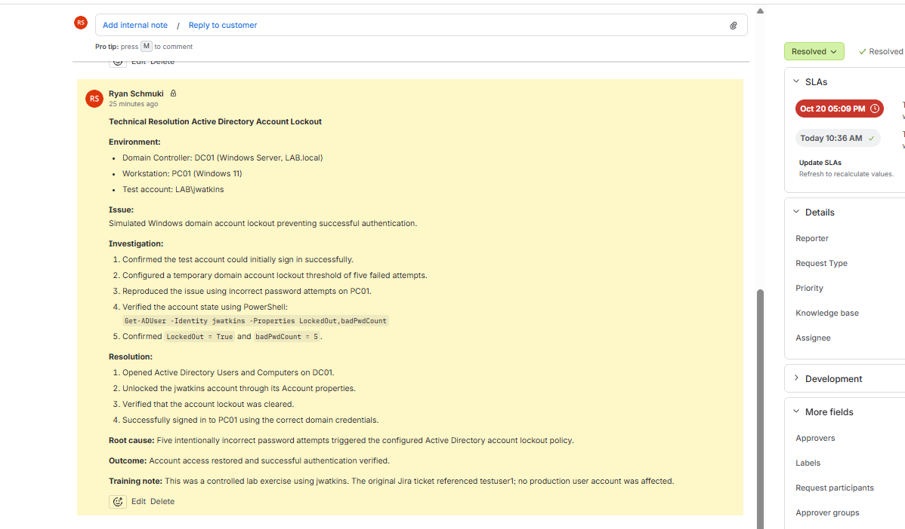
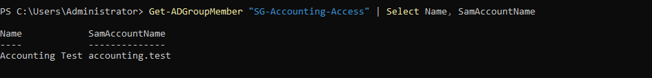
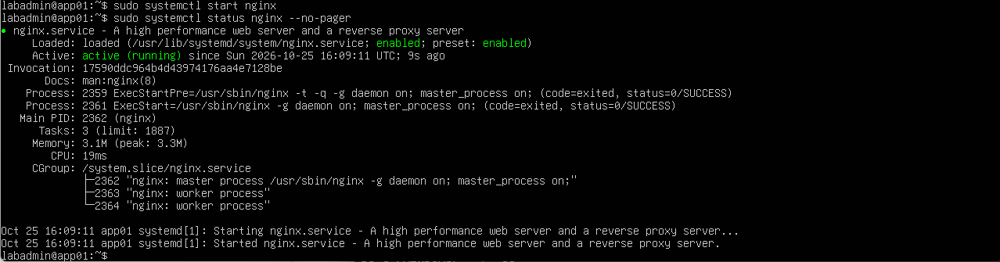
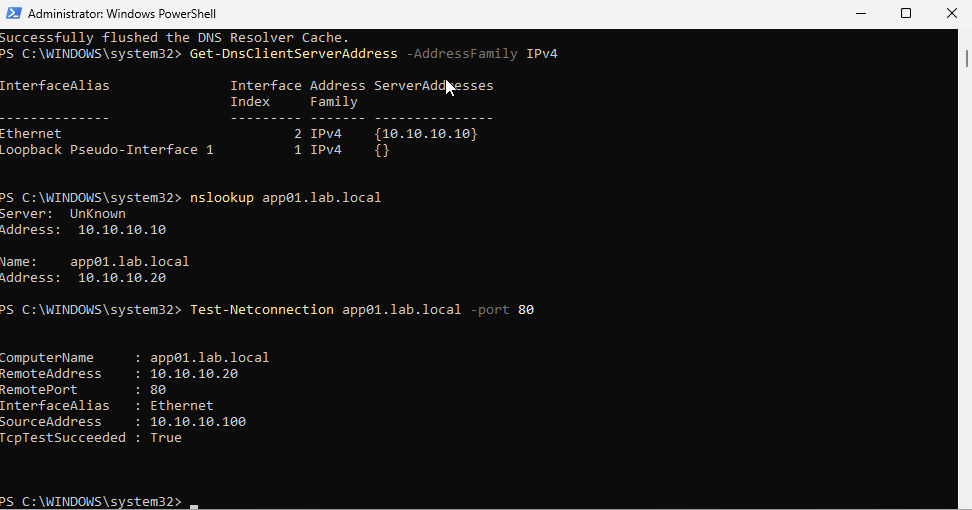
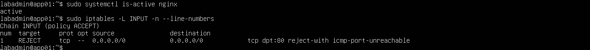
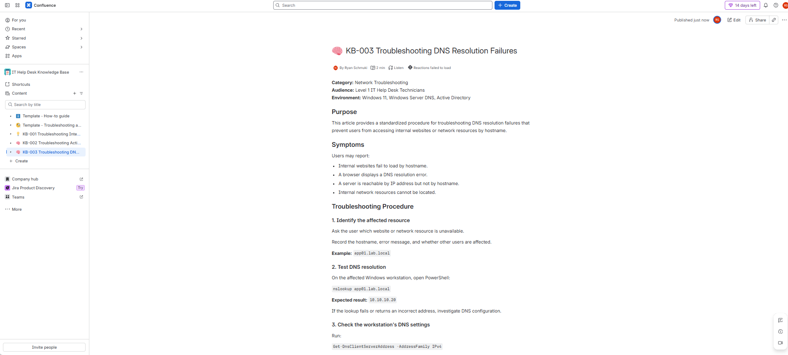
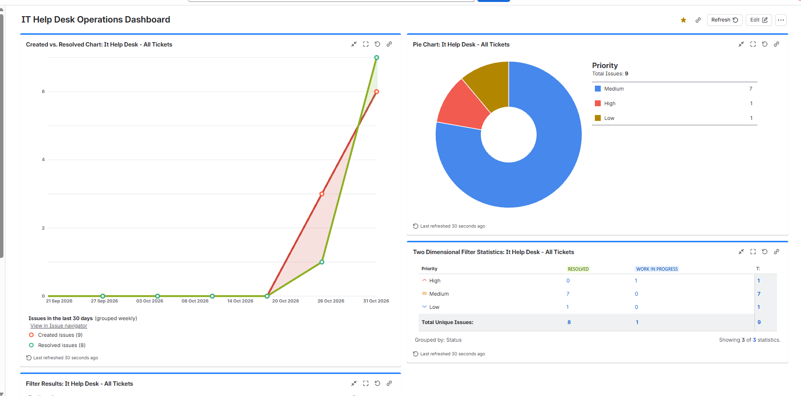
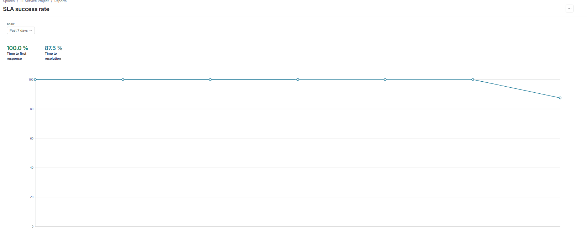

# Jira Service Management IT Help Desk Lab

## Project Overview

This project demonstrates the setup and operation of a simulated IT help desk using Jira Service Management, Confluence, Windows Active Directory, and a virtualized infrastructure lab.

I created realistic IT support tickets, configured service-level agreements (SLAs), managed Active Directory accounts and security groups, diagnosed application and network failures, and documented resolutions using professional service desk workflows.

The goal was to gain hands-on experience with the technical troubleshooting, ticket management, and documentation responsibilities of a Level 1 IT Support Technician.

**Project type:** Independent home lab / simulated IT support environment

## Technologies Used

- Jira Service Management — ticketing, queues, SLAs, escalation, and reporting
- Confluence — knowledge base documentation
- Proxmox VE — virtualized lab infrastructure
- Windows Server — Active Directory Domain Services and DNS
- Windows 11 — domain-joined client workstation
- PowerShell — account administration and network diagnostics
- Ubuntu Linux — application hosting and troubleshooting
- Nginx — internal web server
- Linux systemctl and iptables — service and firewall management

## Lab Environment

| System | Role | IP Address |
|---|---|---|
| DC01 | Active Directory Domain Controller / DNS | 10.10.10.10 |
| PC01 | Windows 11 client workstation | 10.10.10.100 |
| APP01 | Ubuntu Linux / Nginx web server | 10.10.10.20 |

**Active Directory domain:** LAB.local

The environment runs on Proxmox VE and supports hands-on Windows administration, authentication, DNS, application, and network troubleshooting.

## Jira Service Desk Configuration

Configured a Jira Service Management project to simulate an internal IT support department.

Implemented:
- Employee facing IT support request portal
- Ticket assignment, prioritization, and resolution workflows
- Queues for unassigned, high-priority, and customer-pending requests
- Escalation tracking for a simulated departmental network incident
- Internal technical notes and customer-facing responses
- Custom resolution categories
- Priority-based response and resolution SLAs

### SLA Targets

| Priority | First Response | Resolution |
|---|---|---|
| Highest | 15 minutes | 4 hours |
| High | 30 minutes | 8 hours |
| Medium | 4 hours | 48 hours |
| Low / Lowest | 8 hours | 120 hours |

Resolution SLAs were configured to pause while waiting for customer input.

## Hands-On Support Scenarios

### 1. Active Directory Account Lockout

Simulated repeated failed sign-in attempts against a test domain account.

**Troubleshooting and resolution:**
- Verified the account lockout using Active Directory and PowerShell.
- Unlocked the account using administrative tools.
- Confirmed successful authentication from the Windows 11 workstation.
- Documented the investigation and resolution in Jira.

### 2. Active Directory Password Reset and Access Management

Practiced standard account administration procedures:
- Resetting a domain user's password
- Requiring a password change at next sign-in
- Verifying successful workstation authentication
- Creating an Accounting security group
- Adding and removing a test account from the group
- Verifying group membership using PowerShell

### 3. Nginx Application Outage

Simulated an internal website outage by stopping Nginx on APP01.

**Investigation:**
- Confirmed hostname resolution using nslookup.
- Verified IP connectivity using ping.
- Identified failed TCP connectivity on port 80.
- Confirmed the Nginx service was inactive.

**Resolution:** Started Nginx and verified the website loaded successfully.

### 4. DNS Resolution Failure

Temporarily configured PC01 to use an incorrect DNS server.

**Investigation:**
- Confirmed internal hostname resolution failed.
- Verified APP01 remained reachable by IP address.
- Confirmed HTTP port 80 remained accessible by IP.
- Identified the workstation DNS configuration as the cause.

**Resolution:** Restored the correct internal DNS settings, flushed the DNS resolver cache, and verified hostname resolution.

### 5. Firewall Connectivity Failure

Simulated an HTTP connectivity failure using a temporary Linux iptables rule.

**Investigation:**
- Confirmed APP01 responded to ping.
- Identified failed TCP connectivity on port 80.
- Verified Nginx remained active.
- Identified an inbound firewall rule rejecting HTTP connections.

**Resolution:** Removed the temporary rule and verified restored HTTP connectivity.

## Knowledge Base Documentation

Created three Confluence knowledge base articles:

1. KB-001 — Troubleshooting Internal Website Connectivity (Nginx)
2. KB-002 — Troubleshooting Active Directory Account Lockouts
3. KB-003 — Troubleshooting DNS Resolution Failures

Each article provides reusable diagnostic procedures, corrective actions, verification steps, and escalation guidance.

## Reporting and SLA Performance

Created Jira reports and an IT Help Desk Operations Dashboard to monitor ticket activity.

### Lab Results

| Metric | Result |
|---|---|
| Tickets created | 9 |
| Tickets resolved | 8 |
| Tickets remaining in progress | 1 |
| Ticket resolution rate | 88.9% |
| SLA measurements met | 7 |
| SLA measurements breached | 1 |
| First-response SLA success | 100% |
| Resolution SLA success | 87.5% |

These values represent a snapshot of the simulated lab environment, not production service desk performance.

The unresolved ticket represents a simulated Accounting department network outage that was documented and escalated but not falsely marked as repaired.

### Operations Dashboard

Configured four Jira gadgets:
- Created vs. Resolved Chart
- Priority Pie Chart
- Two Dimensional Filter Statistics
- Filter Results

### SLA Reporting

## Troubleshooting Methodology

For technical incidents, I followed a consistent support process:

1. Identify the reported symptom.
2. Reproduce the issue where possible.
3. Test DNS, network connectivity, and application availability.
4. Isolate the failing component using diagnostic evidence.
5. Apply an appropriate corrective action.
6. Verify the service or account is working.
7. Document the root cause, resolution, and user communication in Jira.

## Skills Demonstrated

- IT service desk ticket lifecycle management
- Incident triage, prioritization, and escalation
- Active Directory account administration
- Windows authentication troubleshooting
- PowerShell administration and diagnostics
- DNS and TCP/IP troubleshooting
- Linux service and firewall troubleshooting
- SLA configuration and performance analysis
- Technical knowledge base writing
- Customer-facing and internal support communication
- Jira dashboards and operational reporting

## Related Project

This help desk lab builds on my existing Proxmox infrastructure project:

[Enterprise Infrastructure Lab](https://github.com/rSchmuki/enterprise-infrastructure-lab)

## Project Scope

All employee requests and incidents were simulated for training purposes. Active Directory changes, Nginx service operations, DNS misconfiguration and recovery, and firewall troubleshooting were performed within a controlled virtualized lab.

No production users or business systems were involved.
